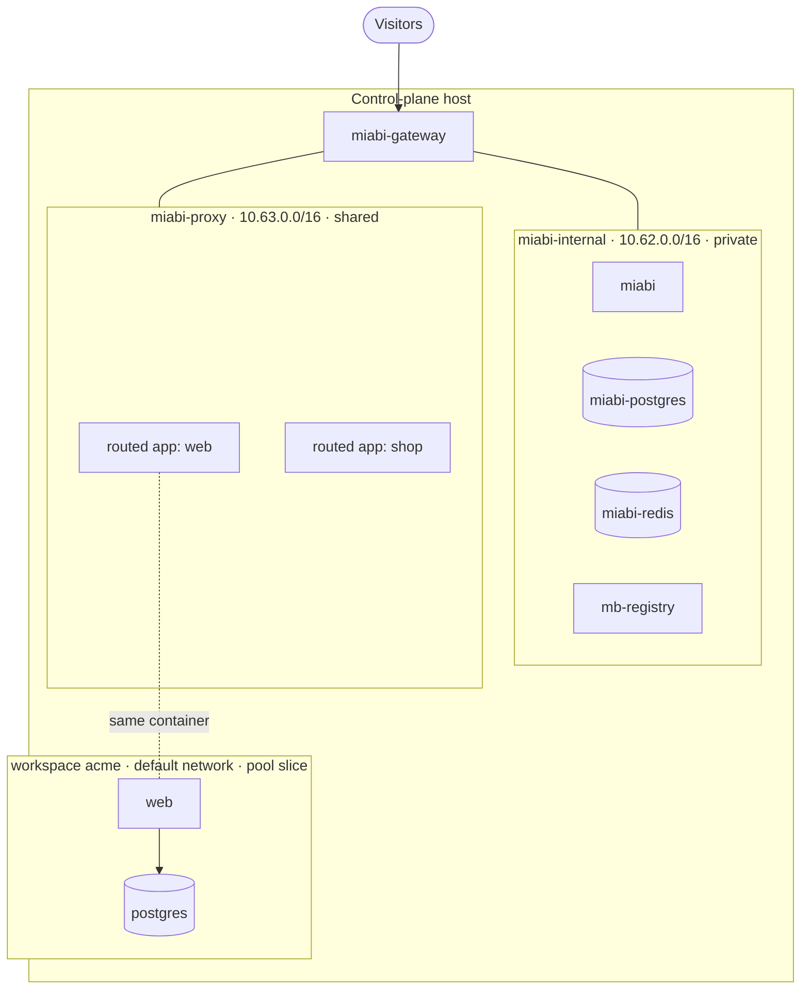

# Networks overview

Miabi creates and addresses every Docker network it needs, so a workspace never deals with drivers,
subnets or nodes. There are two families:

- **Workspace networks** belong to a workspace: its default network, the custom networks its members
  create, and each stack's private network. Members manage them under **Networks**; see
  [Workspace networks](/docs/networking/workspace-networks).
- **Platform networks** belong to the install: the proxy network the gateway shares with routed apps,
  the private network of Miabi's own components, and in a swarm cluster the ingress overlay. Platform
  admins see them, and every subnet, under [Admin → Networks](/docs/administration/networks).



*The gateway is the only container on both platform networks. A routed app joins `miabi-proxy` beside
its workspace network; an app without a route stays on its workspace network only.*

| Network | Family | Driver | Who joins it | Subnet |
|---|---|---|---|---|
| Workspace default | Workspace | bridge, or overlay in a swarm | Every app, database and job of the workspace | From the pool |
| Workspace custom | Workspace | bridge, or overlay in a swarm | What a member attaches | From the pool |
| Stack network | Workspace | bridge, or overlay in a swarm | The stack's apps | From the pool |
| `miabi-proxy` | Platform | bridge, one per node running a gateway | The gateway and every routed app | `MIABI_PROXY_SUBNET`, default `10.63.0.0/16` |
| `miabi-internal` | Platform | bridge, control-plane host only | Miabi, its database, Redis, the registry, the gateway | `10.62.0.0/16` |
| `miabi-ingress` | Platform | encrypted overlay, one per swarm cluster | The cluster's gateways and its routed apps | From the pool |

## Workspace networks

Each workspace gets a default network that every app, database and job joins, and members can add
custom ones. In a swarm cluster they are encrypted overlays spanning the nodes; elsewhere they are
node-local bridges. [Workspace networks](/docs/networking/workspace-networks) covers creating,
attaching and reading them. Enabling cluster mode converts existing workspaces; see
[Applying it to existing workspaces](/docs/nodes/cluster-mode#applying-it-to-existing-workspaces).

## The shared gateway network

The gateway and every routed app/database container share one bridge network —
`miabi-proxy` by default (`MIABI_PROXY_NETWORK`). Because *all* exposed containers on the host pile onto
this single network, it needs plenty of address space, so it is treated differently from the
per-workspace networks above:

- **A roomy, explicit CIDR on a managed install.** `install.sh` and `miabi setup` create it with
  `10.63.0.0/16` (~65k addresses) instead of a slice of Docker's small default pool. Choose another
  range with `MIABI_SUBNET` or `--subnet` — see [Changing the subnets](#changing-the-subnets).
- **The same subnet on every node.** A remote node that runs a gateway creates its own `miabi-proxy`
  with the subnet in `MIABI_PROXY_SUBNET`, which `miabi setup` writes from the manifest. Unset, nodes
  copy the control plane's proxy network, and without one they use `10.63.0.0/16`. Only that unset
  default yields to Docker's pool on a host where it overlaps another network; a subnet you set is never
  second-guessed. [Admin → Networks](/docs/administration/networks#configuration) shows which source
  is in force.
- **Distinct from the workspace pool.** Its CIDR must not overlap `MIABI_NETWORK_POOL_CIDR` (the
  `10.64.0.0/12` pool below) or your LAN. The default `10.63.0.0/16` sits just outside the pool.

The [Compose files](https://github.com/miabi-io/miabi/tree/main/examples/compose) declare `miabi-proxy` as
an ordinary Compose network, so Compose creates it (and `docker compose down` removes it) with a subnet
from Docker's default address pools. Add an `ipam` block to the network in your Compose file if you
need a specific range.

## The platform's private network

Miabi's own components do **not** sit on the shared gateway network. They get a second, private
bridge — `miabi-internal` — and only the gateway is on both. This is true of every install path: a
managed one (`install.sh`, `miabi setup`) creates it with an explicit `10.62.0.0/16`, and the
[Compose files](https://github.com/miabi-io/miabi/tree/main/examples/compose) declare it alongside
`miabi-proxy`.

| Container | `miabi-proxy` (shared) | `miabi-internal` (private) |
|---|---|---|
| `miabi-gateway` | ✅ reaches your apps, and the internet for ACME | ✅ reaches Miabi and Redis |
| `miabi` (control plane) | — | ✅ |
| `miabi-postgres` | — | ✅ |
| `miabi-redis` | — | ✅ |
| `mb-registry` (built-in registry) | — | ✅ |
| your routed apps | ✅ | — |

(On the Traefik Compose variant, Traefik takes the gateway's row.)

The reason is that everything on the shared network can dial everything else on it by name. The
control-plane database has a **single superuser password** covering every workspace and every stored
secret, and Redis holds the background job queue — so one exposed application being compromised
should not put them within reach. After the split, the only way into the platform is through the
gateway, where your [routes and middlewares](/docs/networking/routing-and-middlewares) — rate limits,
IP allowlists, security policies — actually apply.

The built-in registry sits on the private network only for the same reason: it relies on the gateway
to authenticate every request, so app containers must not be able to reach it directly. A Compose
stack needs `MIABI_INTERNAL_NETWORK` set for this — see the upgrade note below.

Nothing about deploying, routing, or connecting apps changes: your containers still join `miabi-proxy`
when they have a route, exactly as before.

### Changing the subnets

On a managed install both CIDRs must miss each other, the workspace pool (`10.64.0.0/12`, below),
and your LAN or VPN:

```bash
curl -fsSL https://get.miabi.io | sudo \
  MIABI_DOMAIN=miabi.example.com \
  MIABI_SUBNET=10.63.0.0/16 \
  MIABI_INTERNAL_SUBNET=10.62.0.0/16 bash
```

They are also flags on `miabi setup` (`--subnet`, `--internal-subnet`) and are recorded in
`/etc/miabi/miabi.yaml`:

```yaml
spec:
  networking:
    proxy:    { name: miabi-proxy,    subnet: 10.63.0.0/16 }
    internal: { name: miabi-internal, subnet: 10.62.0.0/16 }
```

The same block also carries the [managed subnet pool](#managed-subnet-allocation) (`pool`), the host
port range (`hostPorts`), the **default cluster's** wildcard domain for one-click app URLs (`external`
— other clusters set theirs in the cluster's **Edit** dialog, see
[Cluster mode](/docs/nodes/cluster-mode#external-access)) and the managed-DNS
interval (`dns`) — see the [Install Manifest](/docs/administration/install-manifest).

On a remote node that runs a gateway, `miabi-proxy` takes `MIABI_PROXY_SUBNET`. Set it, or
`spec.networking.proxy.subnet` in the manifest, so every node uses the range you chose. A node created
before the change keeps its old subnet until its proxy network is recreated;
[Admin → Networks](/docs/administration/networks#node-network-check) lists such nodes.

:::note Upgrading an existing install
The split happens on your next `miabi upgrade`. The private network is created, every component is
attached to it **while still running**, and only then are the containers recreated on their final
networks — so there is no window where Miabi cannot reach its database. Expect the same brief
restart any upgrade involves.
:::

:::note Upgrading a Compose stack
Pull the new `compose.yaml`, add `MIABI_INTERNAL_NETWORK=miabi-internal` to your `.env`, and
`docker compose up -d` — Compose creates the network and moves the containers onto it. The variable
matters: Miabi reads it to place the helper containers it runs out of process (platform backups, the
built-in registry), and an empty value leaves them on the proxy network alone, where the database no longer is.

On the Traefik variant the control plane also carries `traefik.docker.network=miabi-internal`, since
Traefik's Docker provider otherwise looks for the panel's address on the proxy network and finds none.
:::

:::note Installs created before `miabi-proxy`
The shared network used to be called `miabi`. An existing install keeps that name: `miabi setup`
recorded it in the manifest, and a control plane with `MIABI_PROXY_NETWORK` unset finds the network
on the engine instead of creating a new one. On a Compose stack, keep `MIABI_PROXY_NETWORK=miabi` in
your `.env` — the compose file names the network from it, and an unset value creates `miabi-proxy`
and moves the gateway away from your apps. Compose also refuses the old network, because it was
created under the old key, so adopt it with a `compose.override.yaml` next to `compose.yaml`:

```yaml
networks:
  miabi-proxy:
    name: miabi
    external: true
```
:::

## The ingress overlay

In a [swarm cluster](/docs/nodes/cluster-mode), apps run on any member, but the cluster's gateways run
on a few. Miabi connects them with one encrypted overlay per cluster, `miabi-ingress`:

- the cluster's gateways and every routed app of the cluster join it, under an alias only the gateway
  uses, so workspace names never collide on it;
- unrouted apps stay off it, as they stay off `miabi-proxy`;
- its subnet comes from the pool, so it cannot clash with a workspace network.

To put your own reverse proxy in front of a swarm's apps, attach it to the ingress overlay. The
cluster's page shows the command under **Gateway**.

## Managed subnet allocation

Docker's built-in address pools are small and shared across every network on a host. A platform
that creates many networks — one default per workspace, plus stack, custom, and cluster overlay
networks — can exhaust them, and Docker then fails network creation with:

```
all predefined address pools have been fully subnetted
```

To avoid this, Miabi manages the IP space itself: it carves a unique subnet out of a configurable
**network pool** for every network it creates and hands Docker an explicit subnet, instead of
relying on Docker's defaults.

| Setting | Default | Controls |
|---------|---------|----------|
| `MIABI_NETWORK_POOL_CIDR` | `10.64.0.0/12` | The private supernet subnets are carved from. |
| `MIABI_NETWORK_SUBNET_PREFIX` | `24` | The size of each per-network subnet. |

The default `/12` pool split into `/24`s yields **4096 networks**, each with 254 usable addresses.
The base `10.64.0.0/12` is chosen to steer clear of ranges you're likely to already be using —
common Kubernetes CNI ranges, Docker's own `172.16.0.0/12` and `192.168.0.0/16` pools, and typical
LAN/VPN/Tailscale ranges. Shrink the pool (e.g. a `/16`, 256 networks) or move the base if it
doesn't suit your environment.

How it behaves:

- **Unique & durable** — allocations are recorded so they survive restarts and never overlap.
- **Overlap-safe** — at start-up Miabi reserves the subnets of any pre-existing Docker networks so
  it never hands out a colliding one; if a chosen subnet still collides it is skipped automatically.
- **Reclaimed** — deleting a network returns its subnet to the pool.
- **Consistent across nodes** — a subnet is pinned to its network, not to a node, so a workspace or
  stack network gets the same range on every node it is created on, and a swarm's ingress overlay is
  carved from the pool too.

[Admin → Networks](/docs/administration/networks#subnet-allocations) lists every allocation, and its
node check flags a network created outside the pool or on another subnet.

:::tip
Pick a pool CIDR that doesn't overlap your LAN, VPN, or other private ranges on the host. The
default `10.64.0.0/12` is chosen to avoid the usual suspects (common Kubernetes CNI ranges,
Docker's own pools, and Tailscale's `100.64.0.0/10`), but if it collides with something in your
environment,
set `MIABI_NETWORK_POOL_CIDR` to a free range — for example a spare `/16` like `10.99.0.0/16`.
:::

## IPv6

Every Miabi-created network is IPv4-only by default, and **says so explicitly** — a network that
inherits the daemon's own default follows a setting nobody chose here, which is how a host with IPv6
defaults enabled can end up giving containers routable addresses nobody reasoned about.

Turn it on with `MIABI_NETWORK_IPV6=true`, or in the install manifest:

```yaml
spec:
  networking:
    proxy:    { name: miabi-proxy,    subnet: 10.63.0.0/16, ipv6: true }
    internal: { name: miabi-internal, subnet: 10.62.0.0/16 }
    pool:
      cidr: 10.64.0.0/12
      # ipv6UlaPrefix: fd42:6d69:6162::/48
```

The manifest's `ipv6` drives both halves: the platform's `miabi-proxy` network **and** the workspace
networks the server creates, so a fresh install cannot end up with a dual-stack proxy network in
front of single-stack app networks.

### Turning IPv6 on for an existing install

Docker cannot switch IPv6 on for a network that already exists; it has to be recreated. Run:

```bash
sudo miabi setup --ipv6
```

The plan it prints says which network will be recreated. On confirmation it detaches every container
from `miabi-proxy`, recreates the network with IPv6 and reattaches each container with its aliases.
Routed apps stop answering for a few seconds, so pick a quiet moment. If Docker cannot create the IPv6
network, `setup` puts the IPv4 one back and reattaches everything before reporting the error.

Workspace networks created from then on are dual-stack. Existing workspace networks stay IPv4 until
they are recreated, and the containers on them have no IPv6 address until then.

### Seeing what a network actually got

The stored record says what Miabi *asked* for; the engine decides what exists. Two places show the
engine's answer:

- **A network's page** in the workspace: its IPv4 subnet and gateway, whether IPv6 is on, the IPv6
  subnet and gateway, and on which nodes it exists. See
  [A network's page](/docs/networking/workspace-networks#a-networks-page).
- **[Admin → Networks](/docs/administration/networks#configuration)** — whether IPv6 is on for the
  install, how each `/64` is chosen, the subnet pool and the shared proxy network. It distinguishes
  **requested** from **active**: with `MIABI_NETWORK_IPV6=true` on an engine that cannot honour it, the
  page says so rather than showing a switch that looks stuck.

A cluster overlay only exists on a node once one of its containers attaches there, so a network whose
details read "not present on the control-plane node" is ordinary rather than broken.

Once a container is running, its **Network** tab lists the address it was actually given. The IPv6
column appears only when a container has one — which is also how you spot a container started before
IPv6 was switched on: its network is dual-stack, and it is not.

:::note Addresses are ephemeral
A container's address changes on every redeploy, in both families. Address an app by its hostname or
alias, never by IP.
:::

### Who picks the `/64`

| | Address chosen by | Needs | Addresses are |
|---|---|---|---|
| Default (no ULA prefix) | Docker | **Engine 26+** | assigned by the daemon |
| `ipv6UlaPrefix` set | Miabi, derived from the IPv4 subnet | Engine 25+ | stable and predictable |

Deriving maps the IPv4 subnet onto a `/64` under your prefix, so the two stacks line up:
`10.64.5.0/24` under `fd42:6d69:6162::/48` becomes `fd42:6d69:6162:4005::/64`. The same network gets
the same range on every node and after every recreate, which is what makes a firewall rule possible
to write. The mapping is unique across the whole default pool, so no two networks collide.

:::caution Engine 25
Docker only assigns an IPv6 range itself from Engine 26. On Engine 25, enabling IPv6 **without** a ULA
prefix would make every network create fail — so Miabi refuses to enable it, logs the engine version
and the two ways forward, and carries on in IPv4. Set `ipv6UlaPrefix` to use IPv6 on Engine 25.
:::

:::caution Cluster overlays stay IPv4
This covers **bridge** networks — a single-node install, and each node's local networks. Swarm
overlay networks are not dual-stack yet, so a cluster's cross-node traffic stays IPv4 whatever this
setting says.
:::

:::note Containers get routable addresses
A ULA (`fd00::/8`) range is private, like `10.0.0.0/8`. But enabling IPv6 changes what a container can
reach and be reached on, and Miabi has no IPv6 firewall policy of its own yet
(the node network policy is still on the roadmap). Treat it as you would opening a new
address family on any host.
:::

## Monitoring the pool

Pool usage shows on [Admin → Networks](/docs/administration/networks#configuration), with a warning
from 85%, on the **admin dashboard**, and in Prometheus:

| Metric | Meaning |
|--------|---------|
| `miabi_network_subnet_pool_used` | Subnets allocated or reserved. |
| `miabi_network_subnet_pool_total` | Pool capacity. |

If the pool approaches exhaustion, enlarge `MIABI_NETWORK_POOL_CIDR`. See
[Monitoring](/docs/operations/monitoring) and [Configuration](/docs/getting-started/configuration).
