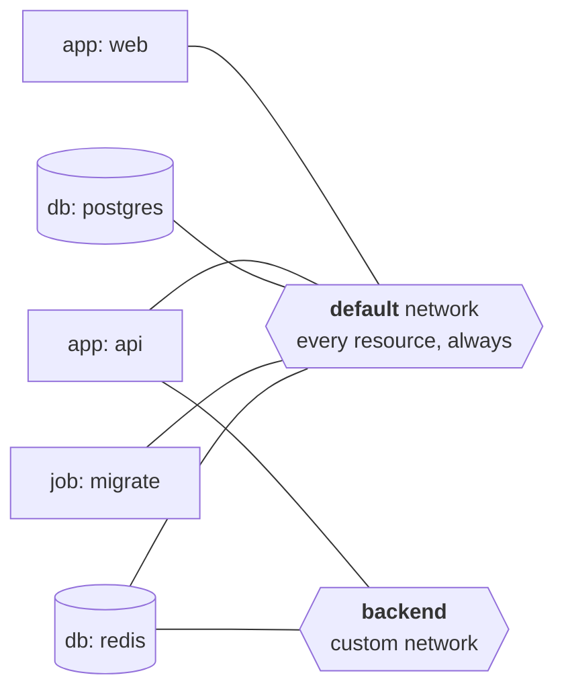

# Workspace Networks

A workspace's apps, databases and jobs talk to each other over private Docker networks that Miabi
creates and manages. You never pick a driver, a subnet or a node: you name a network, attach what
should share it, and Miabi creates it wherever those containers run.

Open them from **Networks** in a workspace's sidebar.

*Everything is on the default network. `api` and `redis` also share `backend`, where both answer to
their names.*

## The default network

Every workspace has a **default network** from the moment it is created.

- Every **application**, **database** and **job** in the workspace joins it, so they reach each other
  by name. Each container answers to its resource's own name, which is what
  `{{ .applications.<name>.host }}` resolves to in a
  [manifest](/docs/cicd/manifest-reference#addressing-another-application).
- It cannot be deleted and nothing can be detached from it.
- It does not count against the plan's network quota.

Address another resource by its name, never by IP. A container's address changes on every redeploy.

## Custom networks

**New network** creates another one: give it a name, and tick **Internal** to cut it off from the
internet (containers on an internal network reach each other, but nothing outside). Custom networks
count against the plan's [Networks quota](/docs/workspaces/plans-and-quotas).

Attach resources to it:

- **Applications:** in the create form, or under the app's **Settings**. The app's **Network** tab lists
  the networks it is on and the hostname it answers to.
- **Databases:** from the database's **Network** tab.

A custom network gives the resources on it a second, separate name space. It does **not** isolate them
from the rest of the workspace: they all stay on the default network as well. Use a custom network to
reach a resource that is only attached there, or to give a group of apps an internal network without
internet access, not as a firewall between apps of the same workspace.

To delete a custom network, detach every application and database first. Miabi then removes it from
every node it was created on. A node that is offline at that moment keeps its copy until a platform
admin removes it from [Admin → Networks](/docs/administration/networks#removing-orphaned-networks).

## Where a network reaches

Miabi picks the driver from the workspace's [location](/docs/nodes/cluster-mode#locations), and
the network page shows the result under **Reach**:

| Location | Driver | Reach |
|---|---|---|
| A single node, or a cluster without Swarm | `bridge` | **Local to each node.** Each node running one of the network's containers gets its own copy, with the same name and subnet, but the copies are not connected. An app on one node cannot reach a database on another, and Miabi refuses to attach them. |
| A [swarm cluster](/docs/nodes/cluster-mode) | `overlay` | **Spans the location, encrypted.** An app on one node reaches a database on another by name, with no published port. |

Networks never span locations: attaching a resource of another location is refused.

## A network's page

Click a network to open its page:

- **Addressing**: the reach, the IPv4 subnet and gateway, and IPv6 when it is on. A subnet marked
  *From Miabi's pool* is the same on every node.
- **Where it exists**: each node of the location, with the network **present**, **not created yet**,
  **unreachable**, or on a **different subnet**. Miabi creates a network on a node when the first
  container that needs it is placed there, so *not created yet* is normal. An overlay also only appears
  on a node once one of its containers attaches there.
- **Attached**: the applications and databases on the network. Click one to open it.

A node on a **different subnet** holds a copy that does not match the pool, usually one created before
the pool existed. Containers there still reach each other, but a platform admin should recreate it from
[Admin → Networks](/docs/administration/networks#node-network-check).

The page asks each node's engine, so it shows what exists rather than what was requested.

## Permissions

Everyone in the workspace can see its networks. Creating, attaching and deleting need the
**Developer** role or higher.

## Related

- [Networks overview](/docs/networking/networks-and-subnets): every network Miabi creates, and the
  subnet pool they come from.
- [Admin → Networks](/docs/administration/networks): the platform view of subnets and node networks.
- [Cluster mode](/docs/nodes/cluster-mode#cluster-networking): moving workspaces onto overlays.
